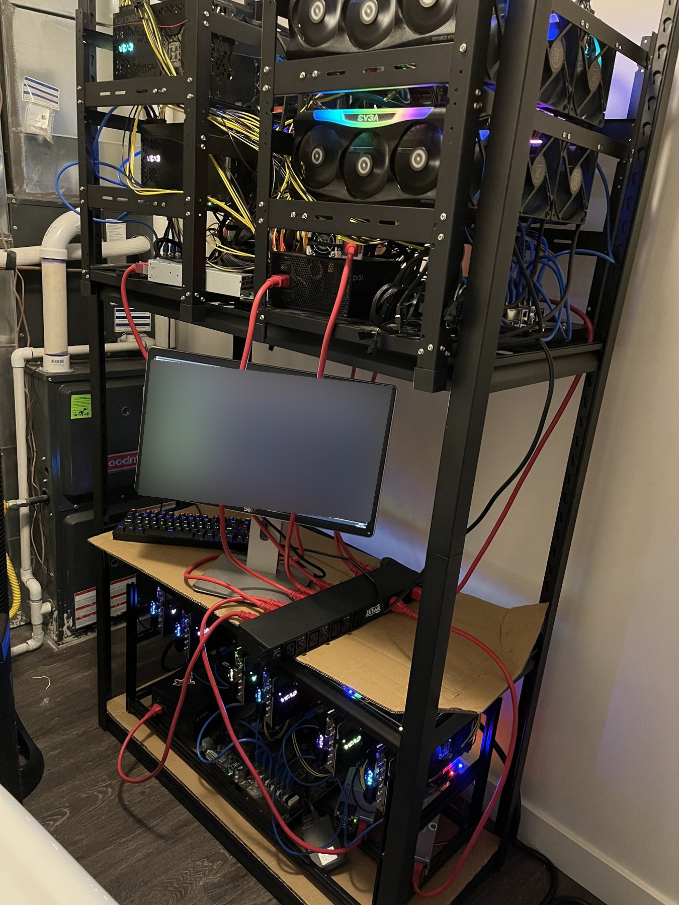
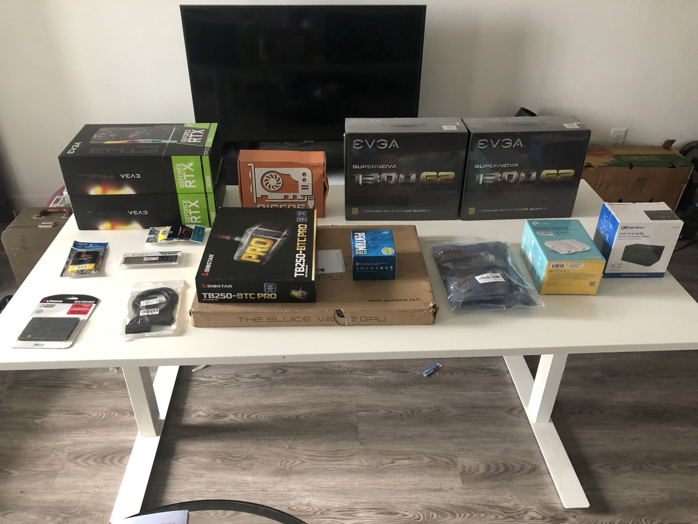
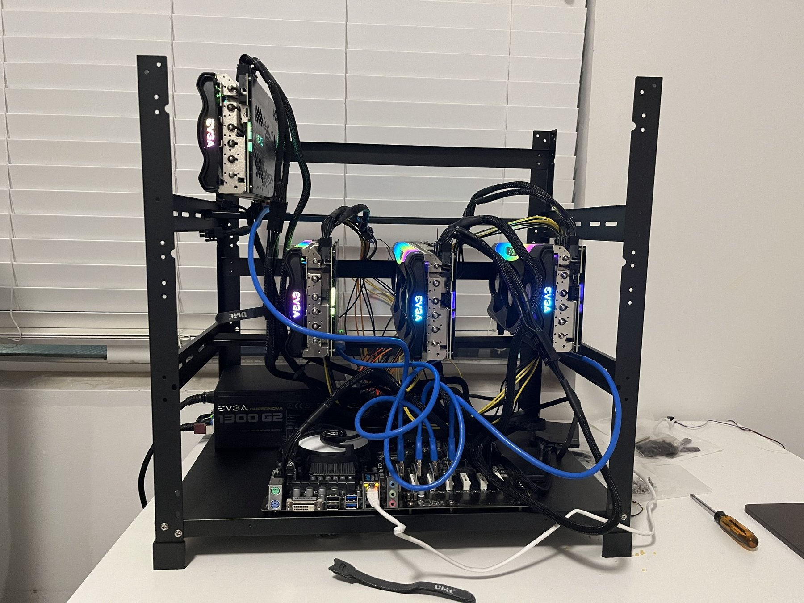
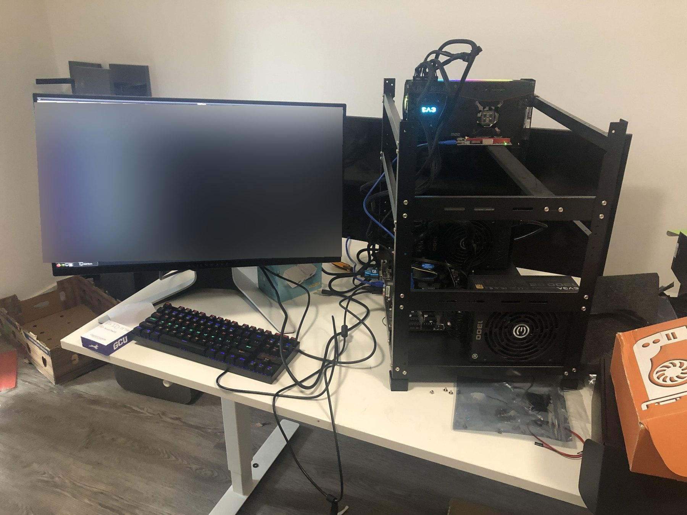
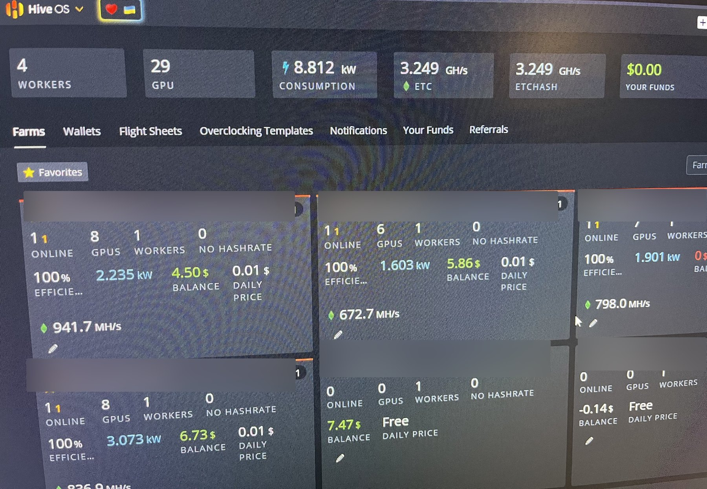
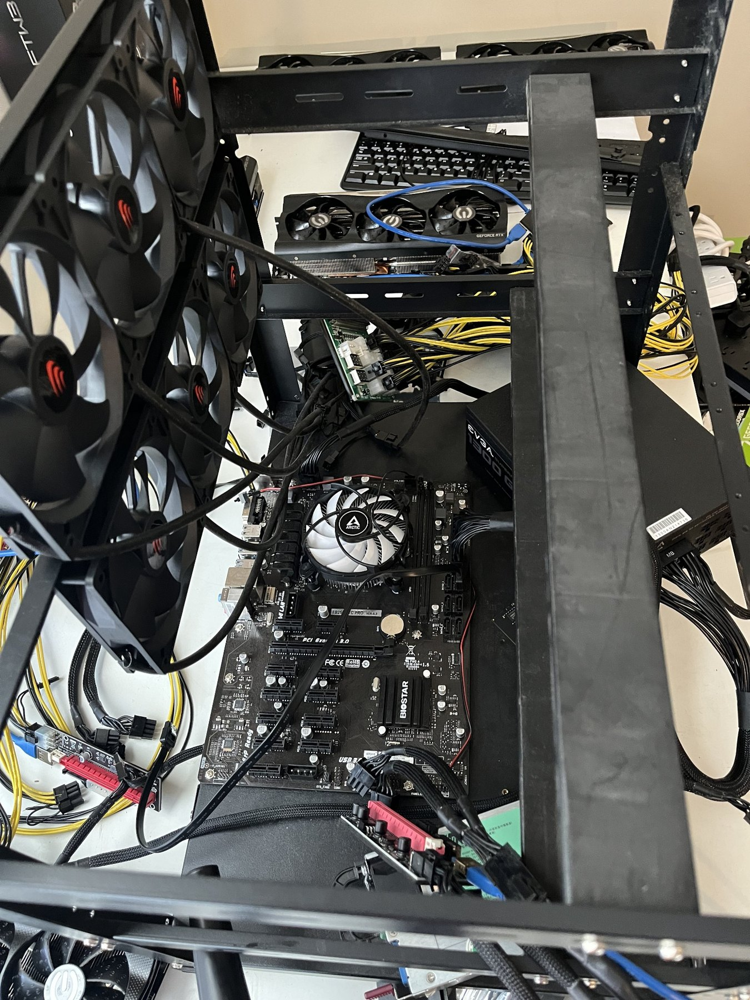
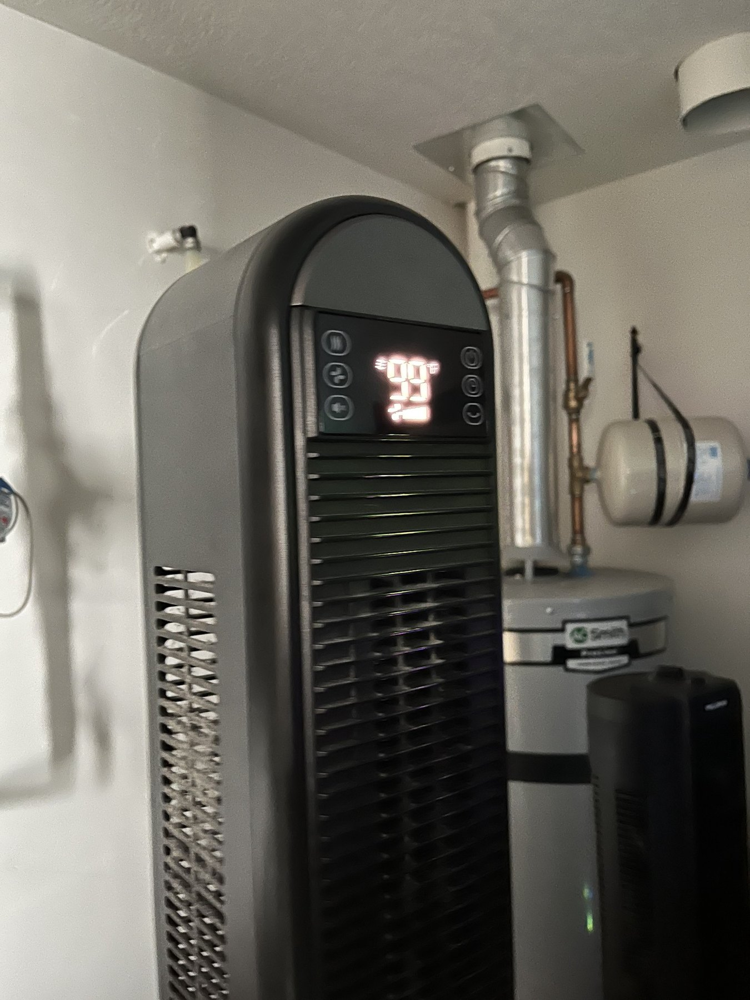
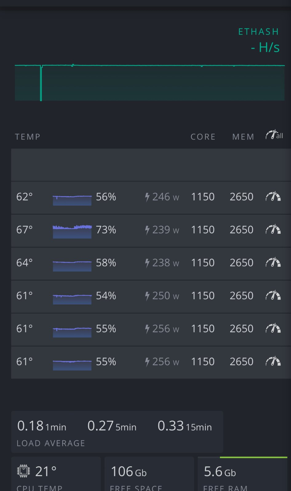
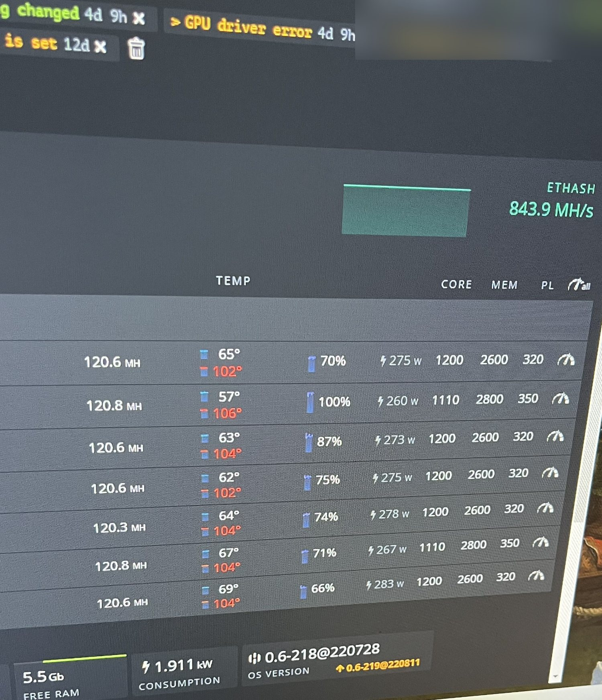

# Multi-GPU Mining Lab

**HiveOS · Custom Hardware Builds · Systems Monitoring · Troubleshooting**

An independent cryptocurrency-mining hardware project I built and managed myself. What started as one custom GPU rig grew into a multi-system setup. Along the way, I configured hardware and operating systems, diagnosed unpredictable GPU dropouts, maintained network connectivity, monitored performance, and adapted cooling and ventilation to a small residential space.

> **Historical personal project, not commercial data-center infrastructure.** The specifications and dashboard figures below are historical snapshots, not current operations. This case study is about hands-on IT troubleshooting and systems management—not investment returns or mining recommendations.

## At a glance

| Area | Historical project |
|---|---|
| Scale recorded in HiveOS | **4 workers / 29 GPUs** |
| System management | **HiveOS**, a Linux-based mining management platform |
| Power reported in one snapshot | **8.812 kW**, a point-in-time dashboard reading |
| My contribution | Personally selected, assembled, configured, maintained, and troubleshot the systems |
| Challenges | Intermittent GPU failures, connectivity, system stability, electrical/thermal constraints, ventilation |

## The build

### 1. From boxed components to a working GPU rig

I started with individual motherboards, graphics cards, power supplies, storage, PCIe risers, rack frames, cables, and cooling components. I assembled the first system, configured it, and brought it online. I documented the parts and the first working rigs as I went.

### 2. Growing to multiple managed systems

I expanded the setup into multiple GPU workers and used HiveOS to track performance, equipment status, temperatures, power consumption, and stability. My saved HiveOS dashboard shows **four workers and 29 GPUs** at one point in the project.

### 3. Diagnosing real problems

A frequent challenge was a rig appearing to run normally before one or two GPUs unexpectedly went offline. I investigated physical connections and operating conditions, disassembled or adjusted components when necessary, and retested the machines.

Heat was another major challenge. Running the rigs in an apartment required dedicated ventilation, an enclosure, and ducted exhaust. The experience taught me how physical constraints and thermal conditions affect reliability as much as software settings do.

## Historical photo gallery

These are **real photographs from the historical project**, arranged from the first components through the expanded setup. Public copies have been prepared with monitor text and identifiable details obscured where needed. Photo filenames are referenced below and the images will render after the nine privacy-reviewed JPEG files are uploaded to `assets/`.

### Building and expanding

| Initial components | First assembled rig |
|:--:|:--:|
|  |  |

| Early testing | Expanded hardware rack |
|:--:|:--:|
|  |  |

### HiveOS monitoring

**Historical farm overview:** four workers and 29 GPUs were visible in this point-in-time capture. It is not a current measurement.

### Troubleshooting and cooling

I monitored individual GPU metrics, investigated unexpected GPU dropouts and driver errors, and addressed the challenges of operating high-heat equipment in a residential space.

| Hardware close-up | Cooling equipment |
|:--:|:--:|
|  |  |

| Per-GPU readings | Driver-error and temperature record |
|:--:|:--:|
|  |  |

The last screenshot shows a **GPU driver error** and memory temperature readings around **102–106°C**, illustrating the kind of thermal and stability issues encountered. These are historical problem records, **not recommended operating temperatures**. I did not retain a photograph of the grow-tent/ducted ventilation arrangement itself.

## Practical experience demonstrated

- **Computer hardware:** assembling and maintaining custom GPU-based computing systems from components.
- **Linux-based tools:** using HiveOS for system configuration, monitoring, and management.
- **Fault isolation:** troubleshooting intermittent GPU disconnections, hardware stability, and connectivity.
- **Ongoing operations:** tracking multiple workers and investigating performance or reliability issues.
- **Environmental constraints:** adapting airflow, ventilation, and operating conditions for a high-heat setup.

## Scope and privacy

This is a personal hardware case study, **not** enterprise infrastructure, a cybersecurity deployment, or a claim of professional systems-administration employment. The original mining and management records are historical. Public media should be reviewed to avoid revealing IP addresses, wallet or account identifiers, worker names, and private information. Historical dates are omitted because the exact timeline has not yet been confirmed.

I built and managed this project independently, before my later AI-assisted cybersecurity projects.
